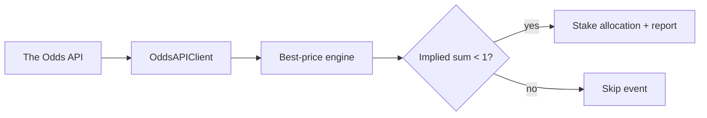

# Sports Betting Arbitrage Scanner

CLI tool that pulls live Australian bookmaker odds from [The Odds API](https://the-odds-api.com/) and flags **cross-book arbitrage** opportunities — positions where stake allocation can lock a theoretical profit regardless of the result.

Built as a portfolio project to demonstrate API integration, quantitative market logic, clean Python packaging, and testable business rules.

---

## Features

- Scans **h2h (moneyline)**, **spreads**, and **totals** markets
- Targets major **Australian** books: Sportsbet, Ladbrokes, TAB, Neds, PointsBet, Unibet, Betr, Betfair Exchange
- Computes **best-price combination**, implied probabilities, profit %, and recommended stake split
- Configurable minimum edge (`--threshold`) and modelled bankroll (`--stake`)
- API key via CLI or `ODDS_API_KEY` / `.env` (never hardcode keys)
- Unit tests for arb detection math (no live API required)

## How it works

For each market, the scanner:

1. Fetches decimal odds for a sport (AU region)
2. Restricts to configured target bookmakers
3. Builds the best available price for every outcome / side
4. Checks whether the sum of inverse odds is **below 1.0**

```
implied_sum = 1/odds₁ + 1/odds₂ + … + 1/oddsₙ
arbitrage    ⇔  implied_sum < 1
profit %     = (1 / implied_sum − 1) × 100
```

Stakes are then sized so each outcome produces the same payout.



## Tech stack

| Layer | Choice |
|--------|--------|
| Language | Python 3.10+ |
| HTTP | `requests` |
| Config | `python-dotenv` |
| CLI | `argparse` |
| Tests | `pytest` |

## Project layout

```
arb_scanner/
  arbs.py       # detection + stake math
  client.py     # Odds API wrapper
  cli.py        # terminal interface
  config.py     # books / sports constants
  display.py    # formatted output
tests/
  test_arbs.py  # pure unit tests on synthetic odds
```

## Setup

```bash
git clone https://github.com/haydenrw2005-cpu/Sports-betting-arbitrage-scanner.git
cd Sports-betting-arbitrage-scanner

python -m venv .venv
# Windows
.venv\Scripts\activate
# macOS / Linux
source .venv/bin/activate

pip install -r requirements.txt
# optional: pip install -r requirements-dev.txt
```

Create a free API key at [the-odds-api.com](https://the-odds-api.com/), then:

```bash
cp .env.example .env
# edit .env and set ODDS_API_KEY=...
```

Or pass `--key` on each run.

> Free tier is quota-limited (each sport/market fetch costs request units). Prefer single-sport scans while developing.

## Usage

```bash
# Default: AFL + NRL head-to-head / spreads / totals
python -m arb_scanner

# One sport
python -m arb_scanner --sport soccer_epl

# Only report edges ≥ 1%
python -m arb_scanner --sport basketball_nba --threshold 1.0

# Custom stake model + full odds tables
python -m arb_scanner --sport rugbyleague_nrl --stake 500 --show-odds

# Explore API coverage
python -m arb_scanner --list-sports
python -m arb_scanner --list-books

# Warning: burns more quota
python -m arb_scanner --all-sports
```

### Example output (illustrative)

```
======================================================================
  H2H Arbs - NRL - 1 found
======================================================================

  [1] Team A vs Team B
      Sport: NRL
      Profit: 1.245%  (implied sum: 0.98770)

      Outcome    Bookmaker    Odds    Stake
      Team A     Sportsbet    2.20    $448.50
      Team B     TAB          2.15    $551.50

      Total stake: $1000.00
      Guaranteed return: $1012.45
      Guaranteed profit: $12.45
  ------------------------------------------------------------
```

## Tests

```bash
pip install -r requirements-dev.txt
pytest -q
```

Tests cover:

- Implied-probability / profit maths
- Stake allocation that equalises returns
- Two-way h2h arb detection across books
- Totals-market arb detection
- Filtering of non-target bookmakers and profit thresholds

## Design choices

- **Package layout** over a single script so scanning logic is unit-testable without live HTTP
- **Target-book filter** so unknown / non-AU books never leak into “best price”
- **Explicit error types** (`OddsAPIError`) instead of bare `except` for clearer CLI failures
- **Stake allocation is display math** — execution risk (account limits, latency, exchange commission, suspended markets) is intentionally out of scope

## Limitations (important)

This project is **for education and portfolio demonstration only**. It is not financial advice and does not place bets.

Real-world arb is harder than the model:

- Odds move between detection and placement
- Some books restrict winners or delay settlement
- Betfair Exchange commissions change net odds
- Totals/spreads need matching lines; thin markets may not fill
- API latency means printed opportunities can already be gone

## Resume / skills highlighted

- Working with third-party REST APIs and quota headers
- Quantitative logic (implied probability, risk-free portfolio of mutually exclusive outcomes)
- Clean module boundaries and CLI UX
- Automated testing of domain rules with synthetic fixtures

## License

MIT — see [LICENSE](LICENSE).
